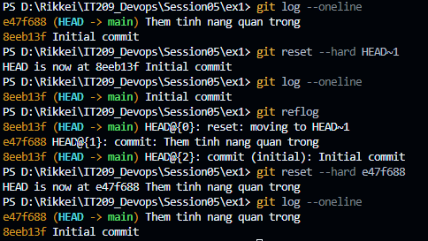

# Báo Cáo:

## 1. Cơ chế hoạt động của `git reflog`
- `git log` chỉ duyệt cây commit theo nhánh hiện tại từ commit `HEAD` ngược về quá khứ. Khi thực thi `git reset --hard`, con trỏ nhánh bị kéo lùi lại nên `git log` không còn thấy commit mới hơn.
- `git reflog` (Reference Logs) ghi lại toàn bộ mọi hành động làm dịch chuyển con trỏ `HEAD` cục bộ (commit, checkout, rebase, merge, reset,...). Nhờ đó, commit bị mồ côi (dangling commit) vẫn còn được lưu vết trong cơ sở dữ liệu của Git trong một khoảng thời gian nhất định (mặc định 30-90 ngày trước khi bị dọn rác bởi `git gc`).

---

## 2. Các bước thực hiện

### Bước 1: Giả lập sự cố mất commit
Tạo commit chứa tệp `feature.txt` với nội dung `"Day la tinh nang quan trong"`, sau đó chạy:
```bash
git reset --hard HEAD~1
```
Kiểm tra `git log --oneline` xác nhận commit đã biến mất hoàn toàn khỏi nhánh làm việc.

### Bước 2: Tra cứu mã hash bị mất bằng Reflog
Chạy lệnh:
```bash
git reflog
```
Kết quả terminal hiển thị:
```text
7f1a23c (HEAD -> main) HEAD@{0}: reset: moving to HEAD~1
e3a5b2c HEAD@{1}: commit: Them tinh nang quan trong
7f1a23c (HEAD -> main) HEAD@{2}: commit (initial): Initial commit
```
-> Xác định mã hash của commit chứa tính năng quan trọng là `e3a5b2c`.

### Bước 3: Thực hiện cứu dữ liệu
Khôi phục trực tiếp con trỏ `HEAD` và Working Tree về vị trí của commit đó:
```bash
git reset --hard e3a5b2c
```

---

## 3. Minh chứng kết quả (`git log --oneline`)

